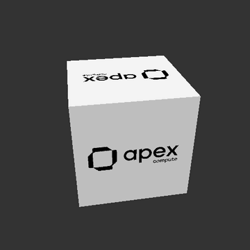
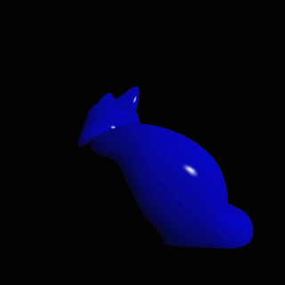
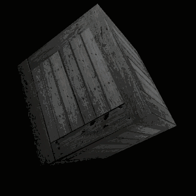

<p align="center">
  
</p>

<p align="center">
  A Vulkan 1.4 GPU for the AMD Kintex-7 (<code>xc7k480t</code>) PCIe board
</p>

<p align="center">
  <br>
  <code>vkcube</code> with the Apex Compute logo, rendered by the Apex GPU on the Kintex-7
</p>

<p align="center">
  <a href="https://discord.gg/SqprdvQXnC"></a>
</p>

# Apex GPU Setup and Usage Guide

This guide takes a new host from a fresh install to `vkcube` spinning on the
card. You build both drivers yourself: the kernel driver from `driver/`, and
the Vulkan driver from the `mesa/` submodule. The GPU image is prebuilt and
encrypted for the board's key.

| Folder | Contents |
| --- | --- |
| `image/` | GPU image for the board's flash |
| `tools/` | `apex_flash.py`, which programs and boots the flash over PCIe |
| `driver/` | Linux kernel driver (`apex_pci`) |
| `mesa/` | Vulkan driver source: Mesa from the `mesa-kintex7` branch of [apex-compute/mesa](https://github.com/apex-compute/mesa) (submodule) |
| `demos/` | Extra demos, such as the Apex Compute cube |
| `requirements.txt` | Ubuntu packages for building and running the drivers |
| `FLASH.md` | Booting and flashing the unified-engine and GPU images |
| `media/` | Images for this guide |

## Prerequisites

- A Kintex-7 board from Apex Compute in a PCIe slot that is x4 or wider and
  PCIe Gen2 or newer. The board's link is Gen2 x4.
- An x86-64 host running Ubuntu 24.04, with `sudo` and internet access.
- Linux 6.11 or newer (tested on 6.11). Check with `uname -r`.
- The BIOS and kernel settings below.
- An X11 display for the cube's window: a desktop on the host, or a remote
  desktop session.

> **Tip:** Ubuntu 24.04's original kernel is 6.8. Install the HWE kernel and
> reboot into it:
> ```bash
> sudo apt install linux-generic-hwe-24.04
> ```

## BIOS and Kernel Settings

Set these in the BIOS (UEFI firmware setup) before installing. Menu names
differ between vendors; the usual names are in brackets.

| Setting | Value | Why |
| --- | --- | --- |
| Secure Boot | Disabled | The kernel driver is built on the host and is not signed; with Secure Boot on, `insmod` fails with `Key was rejected by service`. |
| IOMMU (Intel: VT-d, AMD: AMD-Vi or IOMMU) | Enabled | The driver needs the IOMMU to translate the card's memory accesses; without it the probe fails with `a translated IOMMU domain is required`. |
| Above 4G Decoding (64-bit MMIO, Above 4GB MMIO) | Enabled | The driver resizes the card's BAR2 to 2 GiB, which the host places above 4 GiB. The BAR starts at 256 MiB, so the host boots either way. |
| Resizable BAR (Re-Size BAR Support) | Enabled, if the BIOS has it | Optional: the driver resizes BAR2 itself, but some firmware only reserves room above 4 GiB with it on. |
| PCIe slot link speed | Auto (or Gen2 or higher) | The board links at Gen2 x4 (5 GT/s, 2 GB/s per direction). |

Check them from Linux after boot:

```bash
# Secure Boot: "SecureBoot disabled"
mokutil --sb-state

# IOMMU: lists dmar* (Intel) or ivhd* (AMD) units
ls /sys/class/iommu/

# The card's link: "Speed 5GT/s, Width x4"
sudo lspci -vv -d 10ee: | grep -E "^[0-9a-f]|LnkSta:"
```

If `/sys/class/iommu/` is empty with the IOMMU enabled in the BIOS, turn it on
in the kernel command line and reboot. Do not add `iommu=pt` (passthrough): the
driver needs a translating IOMMU.

```bash
# Intel (AMD hosts enable it by default once the BIOS has it on)
sudo sed -i 's/^GRUB_CMDLINE_LINUX_DEFAULT="/&intel_iommu=on /' /etc/default/grub
sudo update-grub
sudo reboot
```

## Installation

### 1. Get the Repository and Packages

```bash
sudo apt update
sudo apt install git
git clone --recurse-submodules --shallow-submodules https://github.com/apex-compute/apex-gpu.git
cd apex-gpu
sudo apt install linux-headers-$(uname -r) $(grep -v '^#' requirements.txt)
```

Run the remaining steps from the `apex-gpu` folder.

### 2. Flash the GPU Image

Find the card, then program the image into its GPU slot (a few minutes):

```bash
# The card is 10ee:7024 (unified-engine image) or 10ee:a15e (GPU image)
lspci -D -nn -d 10ee:

# Replace with the card's address
export BDF=0000:01:00.0

# Only on 10ee:7024: boot the GPU slot first, since unified-engine cannot program it
sudo python3 -I tools/apex_flash.py boot --slot gpu --bdf $BDF

sudo python3 -I tools/apex_flash.py program image/gpu_k7_flash.bin --slot gpu --bdf $BDF
sudo python3 -I tools/apex_flash.py boot --slot gpu --bdf $BDF

# The GPU image shows up as 10ee:a15e
lspci -s $BDF -n
```

> **Warning:** Let `program` finish; do not interrupt it.
> Programming is needed once; the image stays in the flash. To boot or flash
> either image later, see [FLASH.md](FLASH.md).

### 3. Build and Load the Kernel Driver

```bash
make -C driver
sudo modprobe -a drm_exec drm_gpuvm gpu_sched
sudo insmod driver/apex_pci.ko

# A new render node appears
ls /dev/dri/renderD*
```

> **Tip:** If `modprobe` cannot find `drm_gpuvm`, install the extra modules
> for your kernel:
> ```bash
> sudo apt install linux-modules-extra-$(uname -r)
> ```

> **Tip:** If `insmod` fails with `Key was rejected by service`, Secure Boot is
> on: disable it in the firmware setup, or sign the module.

> **Tip:** If `sudo dmesg | grep apex` shows `a translated IOMMU domain is
> required`, the IOMMU is off or in passthrough mode: see
> [BIOS and Kernel Settings](#bios-and-kernel-settings).

> **Tip:** On kernels older than 6.18 the driver can fail to probe with error
> `-16` (`sudo dmesg | grep apex`). Resize BAR2 to 2 GiB and bind it again:
> ```bash
> echo 11   | sudo tee /sys/bus/pci/devices/$BDF/resource2_resize
> echo $BDF | sudo tee /sys/bus/pci/drivers/apex_gpu/bind
> ```

`insmod` loads the driver until the next reboot; repeat this step after one.

### 4. Give Your User Access to the Card

```bash
sudo usermod -aG render $USER
```

Log out and back in (or start a new SSH session) so the group applies, then
go back to the folder and set the card's address again:

```bash
cd apex-gpu
export BDF=0000:01:00.0
```

### 5. Build the Vulkan Driver

The Vulkan driver is the Apex driver in Mesa, in the `mesa/` submodule that
step 1 cloned. Mesa needs meson 1.4 or newer and Rust 1.85 or newer, which are
newer than the Ubuntu 24.04 packages; the build takes a few minutes:

```bash
# meson and Rust
pipx install 'meson>=1.4' && pipx ensurepath && export PATH=$HOME/.local/bin:$PATH
curl https://sh.rustup.rs -sSf | sh -s -- -y && . "$HOME/.cargo/env"

# Build the Vulkan driver
meson setup build/mesa mesa -Dbuildtype=release -Dstrip=true \
  -Dapex-compiler=true -Dvulkan-drivers= -Dgallium-drivers= -Dplatforms=x11 \
  -Dglx=disabled -Degl=disabled -Dgbm=disabled -Dllvm=disabled
ninja -C build/mesa src/apex/vulkan/libvulkan_apex.so \
  src/apex/vulkan/apex_development_icd.x86_64.json
```

This builds `libvulkan_apex.so` and its manifest,
`build/mesa/src/apex/vulkan/apex_development_icd.x86_64.json`.

> **Tip:** If `mesa/` is empty because the repository was cloned without
> `--recurse-submodules`, fetch it first:
> ```bash
> git submodule update --init --depth 1 mesa
> ```

### 6. Check Vulkan

```bash
export VK_DRIVER_FILES=$PWD/build/mesa/src/apex/vulkan/apex_development_icd.x86_64.json

# deviceName = Apex, apiVersion = 1.4.0
vulkaninfo --summary
```

`VK_DRIVER_FILES` points the Vulkan loader at the driver you built. It is not
installed system-wide, so set it in every shell that runs Vulkan.

### 7. Run vkcube

`vkcube` draws a spinning textured cube. The card renders each frame and the
CPU copies it to an X11 window (`MESA_VK_WSI_DEBUG=sw`), because the card has
no display path to the X server. Expect about 9 frames per second at 512x512.

Without a display, render 300 frames into a virtual X server; it exits with
status 0:

```bash
export VK_DRIVER_FILES=$PWD/build/mesa/src/apex/vulkan/apex_development_icd.x86_64.json
export MESA_VK_WSI_DEBUG=sw
xvfb-run -a vkcube --c 300 --width 512 --height 512; echo "exit $?"
```

To watch it, run it in an X11 desktop on the host. It prints
`Selected GPU 0: Apex, type: DiscreteGpu`; close the window to stop it:

```bash
export VK_DRIVER_FILES=$PWD/build/mesa/src/apex/vulkan/apex_development_icd.x86_64.json
export MESA_VK_WSI_DEBUG=sw
vkcube --width 512 --height 512
```

> **Tip:** On a host without a desktop, install a remote desktop server, connect
> with any RDP client (Windows Remote Desktop, Remmina, Windows App), and run
> the commands above in a terminal there, from the `apex-gpu` folder:
> ```bash
> sudo apt install xrdp xterm openbox
> ```

### 8. Run More Demos

Set the driver and presentation the same way as for `vkcube`, then run any of
these. Each one renders on the card; add `xvfb-run -a` in front to run it
without a display.

```bash
export VK_DRIVER_FILES=$PWD/build/mesa/src/apex/vulkan/apex_development_icd.x86_64.json
export MESA_VK_WSI_DEBUG=sw
```

**vkcubepp**, the C++ version of `vkcube` (from `vulkan-tools`):

```bash
vkcubepp --width 512 --height 512
```

**vkmark**, a Vulkan benchmark: 13 scenes (vertex, texture, shading, 2D
effects, desktop, cube, clear), each for 10 seconds, then a score (the average
frames per second; about 3 on the Kintex-7 at its default 800x600):

```bash
vkmark --winsys xcb -p fifo

# Only some scenes
vkmark --winsys xcb -p fifo -b cube -b texture -b shading:shading=phong
```

**Apex Compute cube**: `vkcube` with the Apex Compute logo as its texture.
`demos/apex-cube/build.sh` fetches Khronos Vulkan-Tools, swaps in the logo and
builds it into `build/apex-cube/vkcube`:

```bash
demos/apex-cube/build.sh
build/apex-cube/vkcube --width 512 --height 512
```

---

## After a Power Cycle

The board loads the unified-engine image at power-up. Boot the GPU slot again (no
need to program it), then load the kernel driver ([step 3](#3-build-and-load-the-kernel-driver)):

```bash
cd apex-gpu
export BDF=0000:01:00.0
sudo python3 -I tools/apex_flash.py boot --slot gpu --bdf $BDF
```

## Gallery

All rendered by the Apex GPU on the Kintex-7, recorded from the demos in
[step 8](#8-run-more-demos).

| Apex Compute cube | vkmark shading (Phong) | vkmark texture (16x anisotropy) |
| :---: | :---: | :---: |
|  |  |  |
| `build/apex-cube/vkcube` | `vkmark -b shading:shading=phong` | `vkmark -b texture:anisotropy=16` |

## Compare With an Integrated Intel GPU

Both devices are in the same Ubuntu 24.04 host: the Kintex-7 board with the
Apex GPU image and drivers from this repository, and the host processor's
integrated Intel Graphics (Arrow Lake) with Ubuntu's Mesa 25.2.8 driver.
`vulkaninfo` reported the properties, limits and features, and `vkmark`
measured the frame rates.

### Devices

| | Intel Graphics (Arrow Lake) | Apex GPU on the Kintex-7 |
| --- | --- | --- |
| Type | Integrated GPU | Discrete PCIe GPU (FPGA) |
| Vulkan version | 1.4.318 | 1.4.0 |
| Khronos conformance | 1.4.0.0 | Not submitted (0.0.0.0) |
| Driver | Intel open-source Mesa driver, Mesa 25.2.8 | Apex, Mesa 26.3.0-devel (`mesa-kintex7`) |
| PCI ID | `8086:7d67` | `10ee:a15e` (Vulkan vendor `0x10009`) |
| Memory | 34.9 GiB, shared with system memory | 2 GiB of DDR3 on the board |
| Subgroup size | 32 | 32 |
| Device extensions | 185 | 93 (all also on the Intel GPU) |
| Core features (of 55) | 51 | 36 |
| Timestamp period | 52.08 ns | 20 ns |
| Host link | Integrated | PCIe Gen2 x4: 2 GB/s per direction raw, about 1.6 GB/s usable |

### vkmark

`vkmark --winsys xcb -p fifo` at its default 800x600, in a virtual X server.
Both devices present the same way: the CPU copies each finished frame to the
window (`MESA_VK_WSI_DEBUG=sw`). The score is the average frame rate.

| Scene | Intel (fps) | Kintex-7 (fps) |
| --- | ---: | ---: |
| vertex, device-local | 171 | 4 |
| vertex, host memory | 171 | 4 |
| texture | 172 | 5 |
| texture, 16x anisotropy | 171 | 4 |
| shading, Gouraud | 170 | 4 |
| shading, Blinn-Phong | 171 | 4 |
| shading, Phong | 170 | 3 |
| shading, cel | 170 | 3 |
| effect2d, edge | 170 | 3 |
| effect2d, blur | 167 | 1 |
| desktop | 168 | 4 |
| cube | 173 | 6 |
| clear | 173 | 2 |
| **Score** | **170** | **3** |

The Intel GPU runs every scene, even `clear`, at the same rate: the frame copy
to the window limits it, so its rendering speed is far above 170 fps. The
Kintex-7 is limited by its single 50 MHz shader core as well as the copy. Every
scene renders correctly on it.

### Limits

| Limit | Intel | Kintex-7 |
| --- | ---: | ---: |
| `maxImageDimension2D` | 16384 | 8192 |
| `maxImageDimension3D` | 2048 | 512 |
| `maxImageArrayLayers` | 2048 | 2048 |
| `maxFramebufferWidth` | 16384 | 8192 |
| `maxColorAttachments` | 8 | 8 |
| `maxBoundDescriptorSets` | 8 | 32 |
| `maxPerStageDescriptorSamplers` | 67108864 | 640 |
| `maxPerStageDescriptorStorageBuffers` | 33554432 | 256 |
| `maxDescriptorSetSampledImages` | 33554432 | 2048 |
| `maxVertexInputAttributes` | 29 | 32 |
| `maxComputeSharedMemorySize` | 65536 | 32768 |
| `maxComputeWorkGroupInvocations` | 1024 | 256 |
| `maxComputeWorkGroupCount` | 65535 x 3 | 65535 x 3 |
| `maxViewports` | 16 | 16 |
| `maxSamplerAnisotropy` | 16 | 16 |
| Color sample counts | 1, 2, 4, 8, 16 | 1, 2, 4, 8 |
| `maxMemoryAllocationCount` | 4294967295 | 4096 |
| `maxPushConstantsSize` | 256 | 256 |
| `maxUniformBufferRange` | 1 GiB | 64 MiB |
| `maxStorageBufferRange` | 4 GiB | 1 GiB |
| `maxClipDistances` | 8 | 8 |
| `pointSizeRange` | 0.125 – 255.875 | 1 – 255.875 |
| `lineWidthRange` | 0 – 8 | 1 – 16 |

## Boot and Flash the unified-engine and GPU Images

The board's flash also holds the
[unified-engine](https://github.com/apex-compute/unified-engine) image. To boot
one image from the other, or to flash a new image into either slot, see
[FLASH.md](FLASH.md).

## License

The kernel driver is GPL-2.0; everything else is MIT. See each file's SPDX
header and `LICENSE`.
